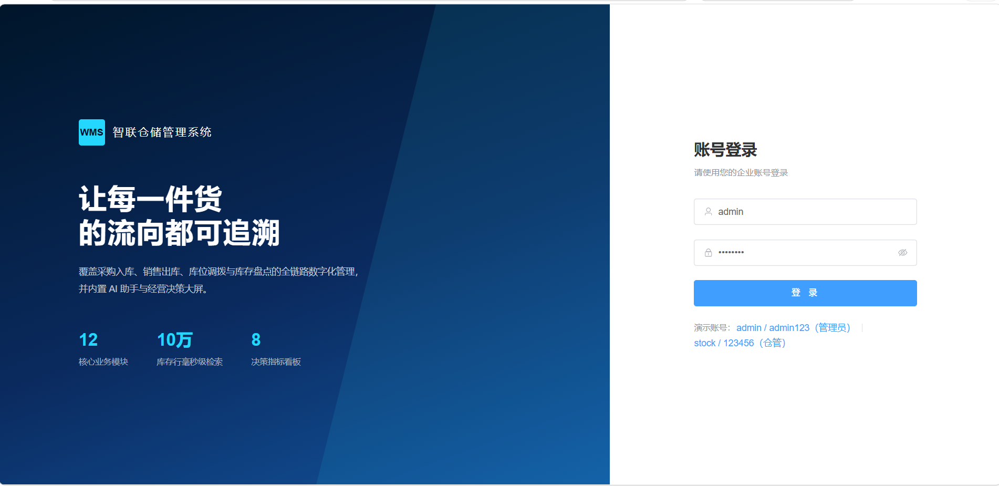
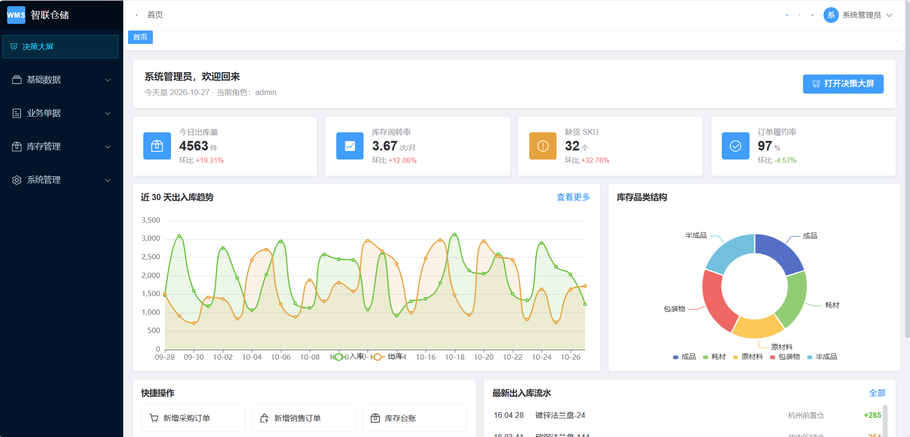
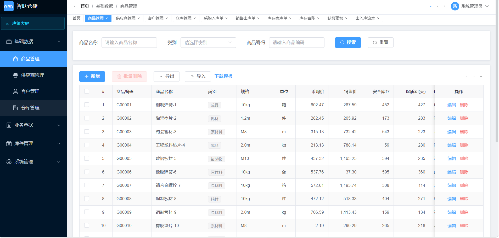
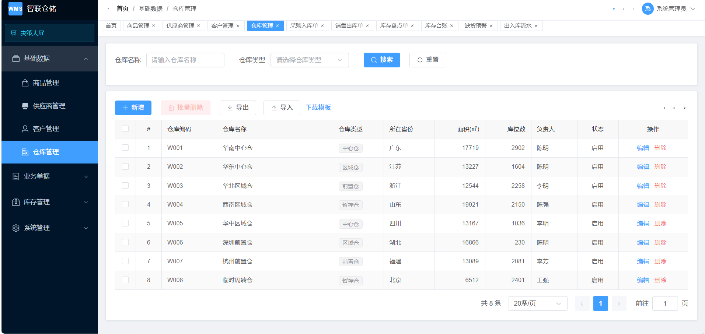
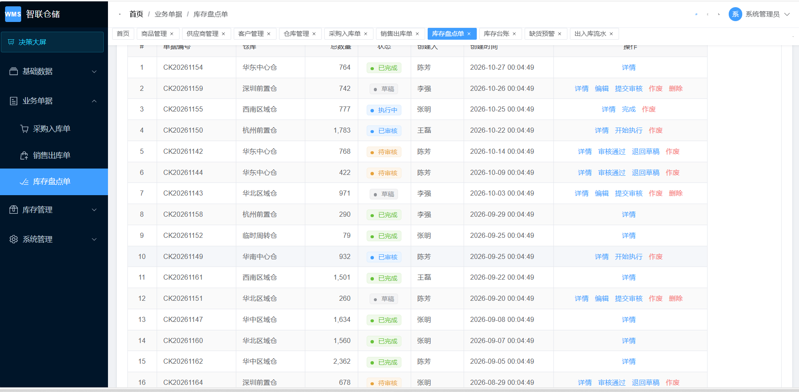
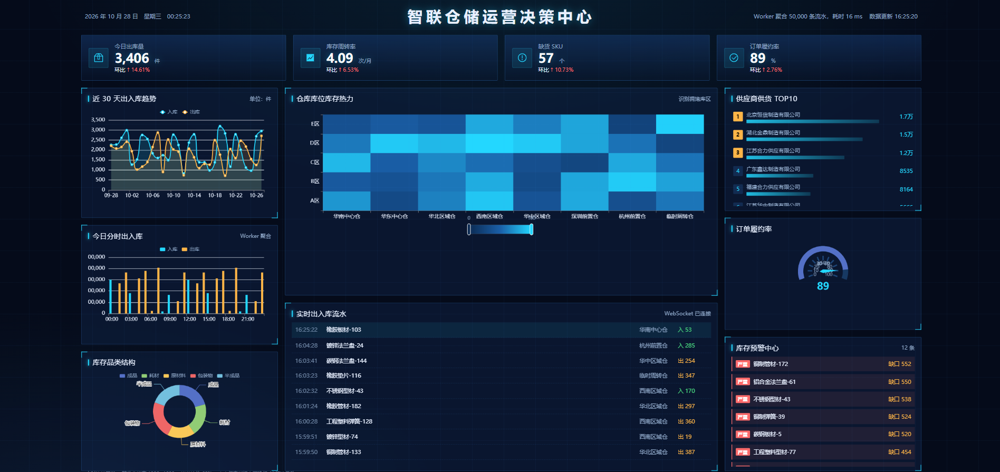
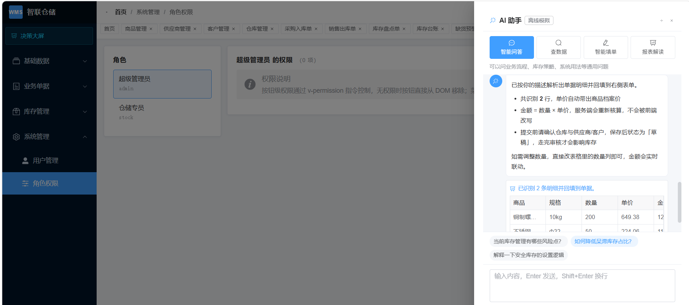

# SmartWMS · 智能仓储管理系统

> 前端项目：**企业中后台（业务中台）+ AI 智能模块 + BI 决策大屏** 三合一。
> 页面风格参考 [RuoYi-Vue-Pro](https://github.com/YunaiV/ruoyi-vue-pro)，
> 业务域选的是**智能仓储 / 进销存**，

## 项目截图








## 技术栈

- **Vue 3.5**（`<script setup>` + TypeScript）+ **Vite 6**
- **Pinia** 状态管理 / **Vue Router 4**（后端驱动的动态路由）
- **Element Plus 2.9**
- **ECharts 5**（按需引入，实例生命周期统一托管）
- **Axios**（双 Token 无感刷新、重复请求取消）
- **SheetJS**（Excel 导入导出与逐行校验）
- **Express + ws**（本地 Mock 服务：鉴权 / 状态机 / SSE / WebSocket）
- **Vitest**（工具函数与状态机单测）

## 快速开始

```bash
# 1. 安装依赖（Node >= 18）
npm install

# 2. 启动：前端 5173 + Mock 服务 48081
npm run dev
```

打开 <http://localhost:5173>，用下面的账号登录：

| 账号 | 密码 | 权限 | 能看到什么 |
| --- | --- | --- | --- |
| `admin` | `admin123` | 超级管理员 `*:*` | 全部菜单（含系统管理）+ 全部仓库数据 |
| `stock` | `123456` | 仓储专员 | 无系统管理菜单、无删除按钮，**只能看所属仓库**的数据 |

> 切换账号即可直观演示：菜单级（路由）、按钮级（`v-permission`）、数据级（`dataScope`）三种权限同时生效。

其他命令：

```bash
npm run dev:api      # 只启 Mock 服务
npm run build        # 生产构建，产物在 dist/
npm run preview      # 预览构建产物（4173）
npm run type-check   # vue-tsc 类型检查
npm test             # 单元测试（格式化 / 字典 / 状态机）
npm run smoke        # 接口冒烟：先启 npm run dev:api，再跑本脚本
```

**决策大屏**：登录后点侧边栏底部「决策大屏」，或直接访问 `/bigscreen`（无需登录，方便投屏）。

---

## 功能地图

```
├── 首页 Dashboard        KPI 卡 + 出入库趋势 + 品类结构 + 实时流水
├── 基础数据              商品 / 供应商 / 客户 / 仓库（通用 CRUD + Excel 导入导出）
├── 业务单据              采购入库单 / 销售出库单 / 库存盘点单（主子表 + 状态机 + AI 填单）
├── 库存管理              库存台账（分页 & 10 万行虚拟滚动对比）/ 缺货预警（AI 解读）/ 出入库流水
├── 系统管理              用户 / 角色权限（按角色配置菜单与按钮权限）
├── AI 助手（侧边抽屉）   通用问答 / 查数据 / 智能填单 / 报表解读
└── 决策大屏 /bigscreen   4 KPI + 趋势/分时/品类 + 库位热力 + 实时流水 + 供应商 TOP + 履约率 + 预警中心
```

---

## 关键实现

### 1. 双 Token 无感刷新（`src/api/request.ts`）

- accessToken 10 分钟、refreshToken 7 天；401 时**挂起并发请求 → 刷新 → 重放**，业务层零感知
- 刷新用**裸 axios** 发起，避免走自身拦截器形成死循环
- refreshToken **轮换制**：换新的同时作废旧 token，长期复用风险被切断
- 想现场演示：把 Mock 服务启动时设 `MOCK_ACCESS_TTL=5000`（5 秒过期），观察 Network 里 401 → refresh → 重放全过程

### 2. 三级权限（`src/directives/permission.ts`、`stores/permission.ts`）

- **菜单级**：后端返回路由树 → `import.meta.glob` 把 `component` 字符串映射成组件 → `router.addRoute('Layout', route)`
  （踩坑点：动态路由必须挂到命名路由 `Layout` 之下，直接 `addRoute(route)` 会脱离布局，页面没有侧边栏）
- **按钮级**：`v-permission` 指令，无权限直接移除 DOM；`*:*` 为超管直通
- **数据级**：`dataScope=WAREHOUSE` 的用户只能看到所属仓库数据，服务端 `scopeFilter` 兜底

### 3. 单据状态机（`src/utils/dict.ts` + `server/index.js`）

`DRAFT → PENDING → APPROVED → RUNNING → FINISHED`，任一状态可 `CANCELED`，作废可退回草稿。
规则**只声明一次**，前端据此渲染按钮，后端 `/api/biz/bill/transfer` 二次校验——因为前端校验可以被绕过。
另：删除只允许草稿/已作废；执行中、已完成不允许修改；金额在服务端重算。

### 4. 10 万行虚拟滚动（`src/components/VirtualTable.vue`）

- 自己实现：`spacer` 撑高 + `translateY` 位移 + 只渲染可视区（约 30 个 DOM 节点）
- 服务端对全量接口做**字段投影**（`toLightInventory`），10 行万传输体积砍半
- 页面提供「普通分页 vs 全量虚拟滚动」开关与耗时对比，能量化说明收益

### 5. AI 模块（`src/components/AiAssistant.vue` + `server/index.js`）

- **SSE 流式**：用 `fetch + ReadableStream` 手动解析 SSE 帧（不用 `EventSource`，因为它不支持 POST），`AbortController` 中断
- **Function Calling**：自然语言 → 结构化查询条件 → 返回 `{chart, columns, rows}` → 前端自动渲染表格与图表
- **上下文压缩**：超过 10 轮的历史折叠为一段摘要，粗估 token（中文 1 字 ≈ 1 token）并在界面上显示
- **降级与兜底**：首 token 60 秒超时主动中断；未配置 `AI_API_KEY` 时自动切换内置离线模型，前端逻辑完全一致
- **安全**：输出前手机号/姓名脱敏，避免业务数据泄漏到展示层

接入真实模型（可选，OpenAI 兼容协议）：

```bash
AI_API_BASE=https://dashscope.aliyuncs.com/compatible-mode/v1 \
AI_API_KEY=sk-xxx \
AI_MODEL=qwen-plus \
node server/index.js
```

### 6. BI 大屏（`src/views/screen/index.vue`）

- **等比缩放**：以 1920×1080 为基准 `transform: scale()`，比 rem/vw 更适合大屏——字体与间距按比例整体缩放，不会出现在超宽屏上比例失调
- **增量更新**：首屏拉全量，之后 WebSocket 只推增量流水；图表 `setOption(option)` 增量合并而非整图重绘
- **Web Worker**：5 万条明细在 Worker 里聚合 24h 出入库与仓库排行，主线程不卡
- **离屏降频**：`visibilitychange` 时暂停推送处理，回到前台再补
- 未使用中国地图（合规与体积考虑），改为**库位热力图 + 条形排行**

### 7. 配置驱动图表引擎（`src/components/ChartRenderer.vue`）

一份 JSON 描述「类型 + 数据 + 字段映射」即可出图，line/bar/pie/heatmap/gauge 统一渲染。
收益：大屏加图表不改代码；AI 查数据的结果可以直接产出配置复用同一套渲染能力。

### 8. Excel 导入（`src/utils/excel.ts`）

SheetJS 解析 → 逐行校验（必填、类型、字典值）→ 返回**带行号的错误清单**弹窗展示，而不是一句「导入失败」。

---

## 目录结构

```
smartwms/
├── server/
│   ├── data.js        # 固定种子随机数据（10 万行库存、200 商品、164 张单据）
│   └── index.js       # Express Mock：鉴权/RBAC/状态机/SSE/WebSocket
├── src/
│   ├── api/           # 接口层：request(双Token) + auth/base/biz/screen/ai
│   ├── components/    # ProTable / CrudPage / BillPage / VirtualTable / ChartRenderer / AiAssistant / DictTag
│   ├── composables/   # useTable / useEcharts / useFormModal / usePermission
│   ├── directives/    # v-permission
│   ├── layouts/       # Sidebar / Navbar / TagsView / AppMain
│   ├── router/        # constantRoutes + guard（动态路由注入）
│   ├── stores/        # user / app / permission / tagsView
│   ├── styles/        # 设计变量 + RuoYi 风格覆写 + 大屏样式
│   ├── utils/         # dict(状态机) / format / excel / auth / emitter
│   ├── views/         # login / dashboard / base / biz / stock / system / screen
│   └── workers/       # aggregate.worker（大屏数据聚合）
├── deploy/            # Nginx 配置、Dockerfile、docker-compose
└── .github/workflows/ # CI：install → type-check → test → build
```

---

## 部署

### 静态资源（Nginx）

```bash
npm run build                      # 产物 dist/
cp -r dist/* /usr/share/nginx/html/
cp deploy/nginx.conf /etc/nginx/conf.d/smartwms.conf
nginx -s reload
```

`deploy/nginx.conf` 已包含：`try_files` 支持 history 路由、`/api` 反代（含 SSE `proxy_buffering off` 与 WebSocket `Upgrade`）、静态资源一年缓存。

### Docker

```bash
cd deploy && docker compose up -d   # 前端容器(nginx:80) + Mock 服务容器(48081)
```
